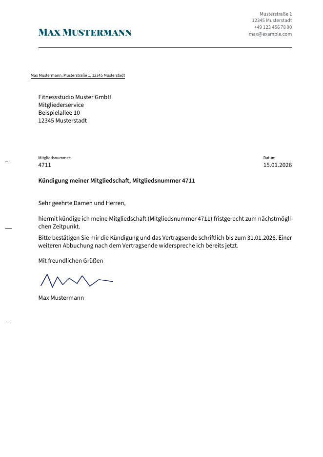
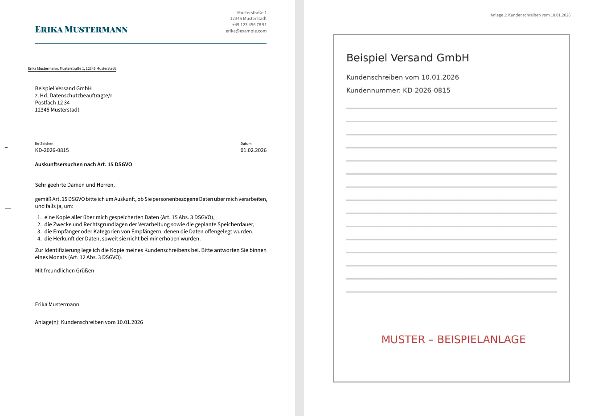

# brieftaube

**German business letters (DIN 5008) with LaTeX — one shared layout, many senders, PDF on save.**

*Deutsch: Formale Briefe nach DIN 5008 mit KOMA-Script und LuaLaTeX. Ein gemeinsames Layout für mehrere Absender, Themenordner für die Briefe, das PDF entsteht beim Speichern direkt neben der `.tex`-Datei. Anlagen (PDF/Bilder) werden automatisch angehängt.*

| Simple letter | Letter with list and attachment |
|---|---|
|  |  |

## Features

- **DIN 5008 Form B** on KOMA-Script `scrlttr2`: window envelope (DIN lang), fold and punch marks, 25/20 mm margins, subject without "Betreff:".
- **Multiple senders, zero config per letter.** Each letter uses the nearest `absender.lco` found by walking up from its folder: everything under `Max/` is from Max, everything under `Erika/` from Erika.
- **Scanned signature** per sender (`unterschrift.png`), or blank space to sign by hand.
- **Attachments**: `\anlage[Title]{file.pdf}` appends PDFs or images (JPG/PNG) and stamps each page with "Anlage N: Title".
- **Page numbers only when needed** (multi-page letters, "1/2" style).
- **Build on save in VS Code** (LaTeX Workshop); the PDF lands next to the `.tex`, auxiliary files go to a hidden `.build/` folder.
- **AI-ready template** (`_vorlage/KI-Briefvorlage.tex`): paste it into any AI assistant together with what you need; clearly marked placeholders tell it what to fill in, and anything it forgets shows up **red** in the PDF.
- **Privacy first**: `.gitignore` keeps your own letters, sender data and signatures out of Git by default.

## Requirements

- A TeX distribution with **LuaLaTeX** and **latexmk**: TeX Live / MacTeX (full) or MiKTeX. Tested with TeX Live 2023 and 2026.
- Optional: **VS Code** with the **LaTeX Workshop** extension for build-on-save.
- Fonts are included (Source Sans 3, Playfair Display SC; SIL Open Font License).

## Quick start

```bash
git clone https://github.com/<you>/brieftaube.git
cd brieftaube
```

1. **Create your sender folder** and copy the sender template into it:
   ```bash
   mkdir -p Max/Vertraege
   cp _vorlage/absender-vorlage.lco Max/absender.lco   # then edit name, address, phone, e-mail
   ```
   Only one sender? Put `absender.lco` directly in the project folder instead.
2. *(Optional)* add your scanned signature as `Max/unterschrift.png` (transparent PNG).
3. **Start a letter** by copying the template into a topic folder:
   ```bash
   cp _vorlage/neuer-brief.tex Max/Vertraege/2026-01-15-Kuendigung.tex
   ```
4. **Build:**
   - **VS Code:** open the project folder itself (File → Open Folder), open the letter, press Save. The PDF appears next to the `.tex`.
   - **Command line:**
     ```bash
     latexmk -r _vorlage/latexmkrc -cd Max/Vertraege/2026-01-15-Kuendigung.tex
     ```

Try it with the examples first:

```bash
latexmk -r _vorlage/latexmkrc -cd beispiele/Max/Vertraege/2026-01-15-Kuendigung-Fitnessstudio.tex
```

## Folder structure

```
brieftaube/
├── .vscode/settings.json      ← LaTeX Workshop: build on save, PDF next to .tex
├── _vorlage/                  ← shared layout — change things here only
│   ├── brief-layout.tex       ← letterhead, margins, fonts, attachments
│   ├── latexmkrc              ← LuaLaTeX + search paths (no need to touch)
│   ├── absender-vorlage.lco   ← sender template to copy
│   ├── neuer-brief.tex        ← template for a new letter
│   ├── KI-Briefvorlage.tex    ← template for AI assistants
│   └── fonts/                 ← Source Sans 3 + Playfair Display SC (OFL)
├── beispiele/                 ← fictional examples (Max & Erika Mustermann)
│   ├── Max/   absender.lco, unterschrift.png, Vertraege/…
│   └── Erika/ absender.lco, Datenschutz/… (with anlagen/)
└── <Person>/                  ← your own folders (ignored by Git)
    ├── absender.lco
    ├── unterschrift.png
    └── <Topic>/<letter>.tex
```

## Writing a letter

```latex
\input{brief-layout}
\hypersetup{pdftitle={Kündigung Mitgliedschaft}}

\setkomavar{subject}{Kündigung meiner Mitgliedschaft}
% \setkomavar{yourref}{AB-12345}               % "Ihr Zeichen"
% \setkomavar{customer}[Kundennummer:~]{4711}  % own reference
% \setkomavar{date}{15.01.2026}                % default: today

\begin{document}
\begin{letter}{%
    Musterfirma GmbH\\
    Beispielweg 3\\
    12345 Musterstadt%
  }
  \opening{Sehr geehrte Damen und Herren,}

  Brieftext …

  \closing{Mit freundlichen Grüßen}
  \encl{Vertragskopie}                          % list under the signature
\end{letter}

\anlage[Vertragskopie]{anlagen/vertrag.pdf}     % appended attachment
\end{document}
```

### Attachments

Put files in an `anlagen/` folder next to the letter and add one line per file **after** `\end{letter}`:

```latex
\anlage[Mietvertrag]{anlagen/mietvertrag.pdf}          % all pages
\anlage[Personalausweis]{anlagen/ausweis.jpg}          % image
\anlage[Rechnung][pages={1,3}]{anlagen/rechnung.pdf}   % selected pages
```

A missing file does not break the build; you get a red "Datei nicht gefunden" page instead.

### Using an AI assistant

Paste `_vorlage/KI-Briefvorlage.tex` into the chat and describe the letter you need (e.g. *"Letter from Erika to her health insurer asking for …"*). The instructions at the top tell the assistant to fill every `\PH{…}` placeholder, keep sender data out of the file, suggest a file name and folder, and follow the LaTeX pitfalls listed there. Edit the list of people in section 2 of that file once for your own project.

## Customising the look

Everything visual lives in `_vorlage/brief-layout.tex`: accent colour (`akzent`), fonts, letterhead, signature spacing. Changes apply to all letters of all senders.

## VS Code notes

- Open the **project folder itself**, otherwise the workspace settings are ignored.
- Letters are detected by `\begin{document}` (they get `\documentclass` from the layout).
- Auto-save is switched off for this folder so that a build only runs for the active letter.
- With the LTeX extension, spell checking is set to German.

## Troubleshooting

| Symptom | Cause / fix |
|---|---|
| `Keine absender.lco gefunden` | The letter is not inside a folder with an `absender.lco` (or below one). |
| `The font "SourceSans3-Regular" cannot be found` | Build with `-r _vorlage/latexmkrc` (sets the font search path). |
| Address line starting with `[` disappears | Write `\\\relax[` instead of `\\[` after a line break. |
| VS Code says "Cannot find LaTeX root file" | Open the project folder itself and make sure the letter tab is active when saving. |

## License

- Code and templates: [MIT](LICENSE).
- Fonts in `_vorlage/fonts/`: SIL Open Font License 1.1 (see the OFL files there). Source Sans 3 © Adobe; Playfair Display © The Playfair Display Project Authors.
